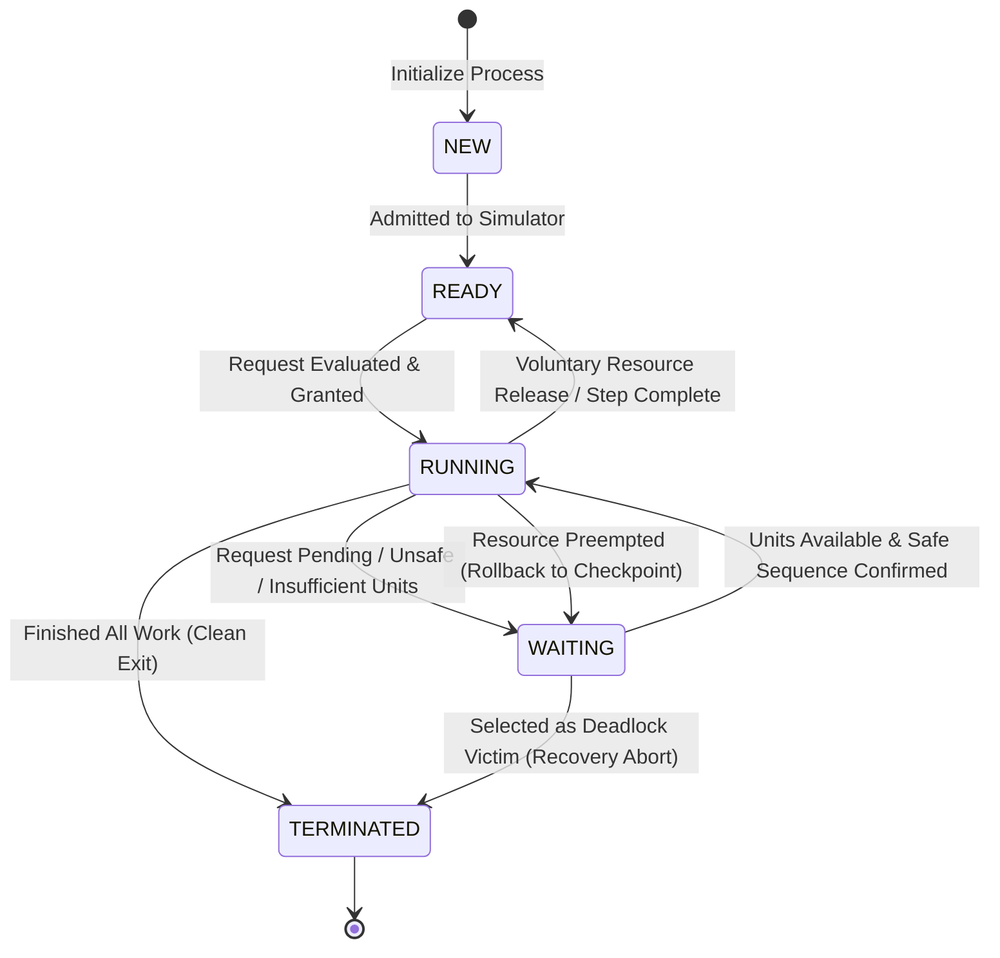
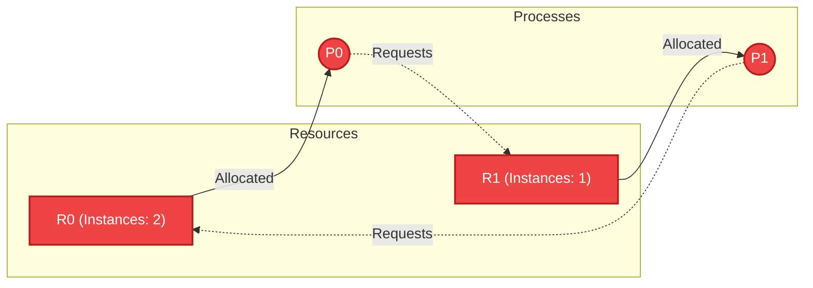

# Deadlock Prevention and Recovery System: Architectural Design Document

**Project Title:** Deadlock Prevention and Recovery System  
**Course-Based Project (CBP):** Advanced Operating Systems & Systems Architecture  
**Document Version:** 1.0.0 (Phase 1: Architectural Design & Technical Blueprint)  
**Author:** Senior OS Systems Engineer & Software Architect  

---

## 1. System Overview & Architectural Style

The **Deadlock Prevention and Recovery System** is architectured as a decoupled, multi-tier system composed of a high-performance **C++ Core Engine** and a modern, responsive **Web-based Visualization & Control Interface**.

```
+------------------------------------------------------------------------------------+
|                                PRESENTATION TIER                                   |
|   HTML5 + Vanilla CSS3 + Modern JavaScript (ES6+)                                  |
|   +-----------------------+ +--------------------+ +---------------------------+   |
|   | Control Dashboard     | | SVG Bipartite RAG  | | Matrix & State Inspector  |   |
|   | (Step, Script, Mode)  | | Graph Renderer     | | (Available, Alloc, etc.)  |   |
|   +-----------------------+ +--------------------+ +---------------------------+   |
+------------------------------------------------------------------------------------+
                                      ▲
                                      │ JSON over HTTP / stdio RPC
                                      ▼
+------------------------------------------------------------------------------------+
|                               COMMUNICATION BRIDGE                                 |
|   +-------------------------------+   +----------------------------------------+   |
|   | Command Dispatcher & Parser   |   | State & RAG JSON Serializer            |   |
|   +-------------------------------+   +----------------------------------------+   |
+------------------------------------------------------------------------------------+
                                      ▲
                                      │ In-Memory Native C++ Calls
                                      ▼
+------------------------------------------------------------------------------------+
|                                 CORE ENGINE TIER                                   |
|                                                                                    |
|   +----------------------------------------------------------------------------+   |
|   |                           Resource Manager                                 |   |
|   |   - Process Registry               - Resource Capacity Tracking            |   |
|   |   - Allocation / Release Mutators  - SystemState Invariant Enforcer        |   |
|   +----------------------------------------------------------------------------+   |
|            ▲                       ▲                      ▲                ▲       |
|            │                       │                      │                │       |
|            ▼                       ▼                      ▼                ▼       |
|   +------------------+   +-------------------+  +------------------+  +----------+ |
|   | PreventionEngine |   |  AvoidanceEngine  |  | DetectionEngine  |  | Recovery | |
|   | - Total Ordering |   | - Safety Checker  |  | - Multi-Instance |  | - Victim | |
|   | - Hold & Wait    |   | - Banker's Request|  |   Matrix Reducer |  | - Abort  | |
|   |   Protocols      |   |   Simulator       |  | - Deadlock Set D |  | - Preempt| |
|   +------------------+   +-------------------+  +------------------+  +----------+ |
+------------------------------------------------------------------------------------+
```

### Architectural Principles
1. **Separation of Concerns:** Algorithmic logic (prevention, avoidance, detection, recovery) is strictly partitioned from state storage (`ResourceManager`) and visualization.
2. **Immutable State Snapshots:** The core engine produces immutable `SystemStateSnapshot` objects for testing, inspection, undo history, and serialization to the frontend.
3. **Speculative Execution Pattern:** Algorithmic decisions in Avoidance (Banker's Algorithm) and Preemptive Recovery operate on cloned tentative states, ensuring that failures never pollute the authoritative state.
4. **Zero Heavyweight Dependencies:** Built cleanly with C++17 Standard Template Library (STL).

---

## 2. Core Data Structures & Matrix Invariants

### 2.1 Core Types and Enums

```cpp
namespace deadlock::core {

enum class ProcessState {
    NEW,          // Initialized, not yet admitted
    READY,        // Eligible for resource allocation
    RUNNING,      // Holds resources and executing
    WAITING,      // Blocked waiting for requested resources
    TERMINATED    // Completed execution or aborted by recovery
};

enum class AllocationPolicy {
    UNCONSTRAINED,            // Raw requests (prone to deadlock; used for Detection testing)
    PREVENTION_TOTAL_ORDER,   // Enforce strict resource hierarchy F(R)
    PREVENTION_HOLD_AND_WAIT, // Enforce all-or-nothing or release-before-request
    AVOIDANCE_BANKER          // Enforce safe-state transitions using Banker's Algorithm
};

enum class RecoveryStrategy {
    ABORT_ALL,                // Abort all deadlocked processes simultaneously
    ITERATIVE_TERMINATION,    // Abort lowest-cost victim one-by-one
    RESOURCE_PREEMPTION       // Preempt resource, roll back process to checkpoint
};

} // namespace deadlock::core
```

---

### 2.2 Process and Resource Entities

```cpp
namespace deadlock::core {

struct ResourceType {
    int id;                   // Unique integer identifier (0 to m-1)
    std::string name;         // e.g., "CPU", "Printer", "MemoryChunk", "DiskUnit"
    int totalCapacity;        // Total physical instances in system (Capacity >= 1)
    int orderRank;            // Global ordering rank F(R_j) for prevention (1 to m)
};

struct ProcessCheckpoint {
    int stepNumber;
    std::vector<int> heldAllocation;
    int cpuTimeSnapshot;
};

struct Process {
    int id;                                // Unique process identifier (0 to n-1)
    std::string name;                      // e.g., "P0", "WorkerThread-1"
    int priority;                          // 1 (lowest) to 10 (highest)
    ProcessState state;                    // Lifecycle state
    int cpuTimeUsed;                       // Execution steps elapsed
    int remainingTime;                     // Steps required to complete task
    int preemptionCount;                   // Starvation protection counter
    std::vector<ProcessCheckpoint> checkpoints; // History stack for rollback
};

} // namespace deadlock::core
```

---

### 2.3 Mathematical Model & SystemState Invariants

Let:
- $n = |P|$ be the number of processes in the system ($P_0, P_1, \dots, P_{n-1}$).
- $m = |R|$ be the number of distinct resource types ($R_0, R_1, \dots, R_{m-1}$).

#### Vectors and Matrices

1. **Capacity Vector** $\vec{C} \in \mathbb{N}^m$:
   - $C[j]$ denotes the total number of physical units of resource type $R_j$.
2. **Available Vector** $\vec{A} \in \mathbb{N}_0^m$:
   - $A[j]$ denotes the number of available (unallocated) units of resource type $R_j$.
3. **Allocation Matrix** $\mathbf{Alloc} \in \mathbb{N}_0^{n \times m}$:
   - $\text{Alloc}[i][j]$ denotes the number of units of resource type $R_j$ currently allocated to process $P_i$.
4. **Request Matrix** $\mathbf{Req} \in \mathbb{N}_0^{n \times m}$:
   - $\text{Req}[i][j]$ denotes the number of units of resource type $R_j$ that process $P_i$ is currently waiting for.
5. **Max Claim Matrix** $\mathbf{Max} \in \mathbb{N}_0^{n \times m}$ (Required for Avoidance):
   - $\text{Max}[i][j]$ denotes the maximum number of units of resource type $R_j$ that process $P_i$ may request during its lifecycle.
6. **Need Matrix** $\mathbf{Need} \in \mathbb{N}_0^{n \times m}$ (Required for Avoidance):
   - $\text{Need}[i][j]$ denotes the remaining resources process $P_i$ may need to complete its task:
     $$\text{Need}[i][j] = \text{Max}[i][j] - \text{Alloc}[i][j]$$

---

### 2.4 Fundamental Invariants (Formally Verified on Every State Transition)

```
Invariant 1: Conservation of Resource Capacity
   For each resource type R_j (j in 0 .. m-1):
   Available[j] + Sum_{i=0}^{n-1} Alloc[i][j] == Capacity[j]

Invariant 2: Element-wise Non-Negativity
   Available[j] >= 0
   Alloc[i][j] >= 0
   Req[i][j] >= 0
   Max[i][j] >= 0
   Need[i][j] >= 0

Invariant 3: Claim Consistency (Avoidance Mode)
   For each process P_i and resource R_j:
   Alloc[i][j] <= Max[i][j] <= Capacity[j]
   Need[i][j] == Max[i][j] - Alloc[i][j]

Invariant 4: Request Legality (Avoidance Mode)
   Req[i][j] <= Need[i][j]
```

---

## 3. Module Boundaries & Class Design

```
+----------------------------------------------------------------------------------------------------+
|                                    MODULE DIRECTORY & INTERFACES                                   |
+----------------------------------------------------------------------------------------------------+
| include/core/ResourceManager.hpp    -> Authoritative state repository & allocation mutators        |
| include/prevention/PreventionEngine.hpp -> Validates requests against static Coffman rules         |
| include/avoidance/AvoidanceEngine.hpp   -> Banker's algorithm, safe sequence computation           |
| include/detection/DetectionEngine.hpp   -> Multi-instance matrix reduction, deadlock set D         |
| include/recovery/RecoveryEngine.hpp     -> Cost-based victim selector, abort & preemption handlers|
| include/bridge/StateSerializer.hpp      -> JSON encoder/decoder for frontend & CLI                 |
| include/bridge/RAGGraphBuilder.hpp      -> Generates Bipartite Resource Allocation Graph nodes/edges|
+----------------------------------------------------------------------------------------------------+
```

### 3.1 `ResourceManager` Class
[ResourceManager](file:///c:/Users/raksh/OneDrive/Desktop/deadlock_prevention/include/core/ResourceManager.hpp) manages authoritative state and enforces physical bounds.

```cpp
namespace deadlock::core {

class ResourceManager {
public:
    ResourceManager(std::vector<ResourceType> resources, std::vector<Process> processes);

    // Mode Configuration
    void setPolicy(AllocationPolicy policy);
    AllocationPolicy getPolicy() const;

    // Mutators (Guarded by validation & invariants)
    bool registerRequest(int processId, const std::vector<int>& requestVector);
    bool grantAllocation(int processId, const std::vector<int>& grantVector);
    bool releaseResources(int processId, const std::vector<int>& releaseVector);
    bool terminateProcess(int processId);
    bool rollbackProcess(int processId, int checkpointIndex);

    // Queries & Snapshots
    const SystemState& getState() const;
    SystemStateSnapshot createSnapshot() const;
    bool verifyInvariants() const;

private:
    SystemState state_;
    AllocationPolicy policy_;
};

} // namespace deadlock::core
```

---

### 3.2 `PreventionEngine` Class (Implemented in Phase 3)
[PreventionEngine](file:///c:/Users/raksh/OneDrive/Desktop/deadlock_prevention/include/prevention/PreventionEngine.hpp) acts as a pre-allocation gatekeeper. It enforces static protocol rules to invalidate specific Coffman conditions prior to resource granting.

```cpp
namespace deadlock::prevention {

enum class PreventionPolicy {
    NONE,                       // Standard unconstrained requests
    HOLD_AND_WAIT_CONSERVATIVE, // Process must acquire all resources at start; no incremental requests allowed
    CIRCULAR_WAIT_TOTAL_ORDER   // Requests must strictly follow increasing resource order rank F(R)
};

struct PreventionCheckResult {
    bool allowed{true};
    std::string reason;

    static PreventionCheckResult Allow() { return {true, ""}; }
    static PreventionCheckResult Reject(const std::string& reason) { return {false, reason}; }
};

class PreventionEngine {
public:
    static PreventionCheckResult validateRequest(
        const core::SystemState& state,
        int processId,
        const std::vector<int>& requestVector,
        PreventionPolicy policy
    );

    // Breaks Coffman Condition #2 (Hold and Wait)
    static PreventionCheckResult validateHoldAndWait(
        const core::SystemState& state,
        int processId,
        const std::vector<int>& requestVector
    );

    // Breaks Coffman Condition #4 (Circular Wait)
    static PreventionCheckResult validateCircularWait(
        const core::SystemState& state,
        int processId,
        const std::vector<int>& requestVector
    );

    static bool verifyUniqueResourceOrdering(
        const core::SystemState& state,
        std::string& outError
    );
};

} // namespace deadlock::prevention
```

#### Mathematical Proof: Why Strict Total Ordering Prevents Circular Wait
1. Assign a strict bijection $F: R \to \{1, 2, \dots, m\}$ such that each resource type $R_j$ has a unique rank.
2. Protocol Rule: A process holding resource instances of type $R_a$ may request instances of $R_b$ if and only if $F(R_b) > F(R_a)$.
3. Proof by Contradiction:
   - Suppose a circular wait chain exists: $P_0 \to R_{(0)} \to P_1 \to R_{(1)} \dots \to P_{k-1} \to R_{(k-1)} \to P_0$, where process $P_i$ holds a resource and waits for a resource held by $P_{(i+1) \bmod k}$.
   - According to the protocol, for each step in the dependency chain, the requested resource must have a strictly higher rank than the highest held resource:
     $$F(R_{(0)}) < F(R_{(1)}) < F(R_{(2)}) < \dots < F(R_{(k-1)}) < F(R_{(0)})$$
   - This transitivity chain implies $F(R_{(0)}) < F(R_{(0)})$, which is an absolute mathematical impossibility.
   - Therefore, a circular wait chain cannot form, and deadlock is prevented.

#### Prevention Policies vs. Avoidance (Banker's Algorithm)
- **Deadlock Prevention:** Imposes static constraints on how requests can be issued. No future claim knowledge ($\mathbf{Max}$ matrix) or safety sequence search is needed. It guarantees deadlock-freedom by invalidating a Coffman condition a priori, but sacrifices runtime concurrency and flexibility.
- **Deadlock Avoidance (Banker's Algorithm):** Dynamically inspects each request against the process's declared maximum claim. It allows arbitrary request ordering and dynamic hold-and-wait, but requires $O(m \cdot n^2)$ runtime safety verification on every request.

#### Limitations of Prevention Policies
1. **Hold-and-Wait Conservative Policy:**
   - *Severely Reduced Resource Utilization:* Resources needed only near the end of a long process must be allocated at the very beginning, idling them for other processes.
   - *Starvation:* A process requiring multiple contended resources simultaneously may wait indefinitely if competing processes hold even one needed resource.
2. **Circular-Wait Total Ordering Policy:**
   - *Restricted Programming Order:* Software workflows must acquire resources according to artificial system ranks rather than natural task execution sequences.
   - *Premature Acquisition:* If a low-rank resource is needed late in execution, it must be acquired early or existing high-rank resources must be released and reacquired.


---

### 3.3 `AvoidanceEngine` Class (Banker's Algorithm)
[AvoidanceEngine](file:///c:/Users/raksh/OneDrive/Desktop/deadlock_prevention/include/avoidance/AvoidanceEngine.hpp) executes Dijkstra's multi-instance safety algorithm.

```cpp
namespace deadlock::avoidance {

struct SafetyResult {
    bool isSafe;
    std::vector<int> safeSequence; // e.g., {1, 3, 0, 2, 4}
    std::string explanation;
};

class AvoidanceEngine {
public:
    // Verifies whether a given state possesses a valid safe execution sequence
    static SafetyResult evaluateSafety(const core::SystemState& state);

    // Evaluates speculative resource request
    static SafetyResult evaluateRequest(
        const core::SystemState& state,
        int processId,
        const std::vector<int>& requestVector
    );
};

} // namespace deadlock::avoidance
```

---

### 3.4 `DetectionEngine` Class (Implemented in Phase 4)
[DetectionEngine](file:///c:/Users/raksh/OneDrive/Desktop/deadlock_prevention/include/detection/DetectionEngine.hpp) implements the Shoshani-Coffman matrix reduction algorithm for systems with multiple instances per resource type.

```cpp
namespace deadlock::detection {

struct DetectionResult {
    bool validState{true};                 ///< True if system state satisfies all mathematical invariants
    std::string stateError;                ///< Invariant violation description if state is invalid
    bool isDeadlocked{false};              ///< True if at least one process cannot complete (deadlocked subset D is non-empty)
    std::vector<int> deadlockedProcessIds; ///< Process IDs belonging to the deadlocked set D
    std::vector<int> reducibleProcessIds;  ///< Process IDs that successfully completed in reduction sequence
    std::vector<int> finalWork;            ///< Unallocated Work vector at reduction termination
    std::vector<std::string> reductionSteps; ///< Detailed trace of each reduction step
    std::string diagnosticReport;          ///< Comprehensive human-readable report
};

class DetectionEngine {
public:
    static DetectionResult detectDeadlock(const core::SystemState& state);
};

} // namespace deadlock::detection
```

#### Algorithm Complexity & Resource Scaling
- **Time Complexity:** $O(m \cdot n^2)$ in worst case.
  - Initializing `Work` takes $O(m)$.
  - Initializing `Finish` takes $O(m \cdot n)$ to check non-zero allocations.
  - The matrix reduction loop checks at most $n$ unfinished processes. In each pass, comparing $\text{Request}_i \le \text{Work}$ takes $O(m)$.
  - In the worst case, exactly one process finishes per outer pass, requiring $n$ iterations of the outer loop $\implies O(m \cdot n^2)$.
- **Space Complexity:** $O(m + n)$.
  - $O(m)$ for local `Work` vector.
  - $O(n)$ for local `Finish` boolean array.
  - Zero side effects on live simulation state.

#### Model Assumptions & Theoretical Principles
1. **Optimistic Completion Assumption:** The algorithm assumes that any process whose current outstanding requests can be satisfied ($\text{Request}_i \le \text{Work}$) will eventually run to completion without making further unanticipated requests, subsequently relinquishing all currently held resources ($\text{Allocation}_i$) back to the unallocated pool.
2. **Zero-Allocation Invariance:** Processes currently holding zero allocated resources ($\text{Allocation}_i == \vec{0}$) cannot cause or perpetuate a deadlock because they hold no physical units that other processes are waiting for. They are safely initialized with $\text{Finish}[i] = \text{true}$.
3. **Blocked State $\neq$ Deadlocked State:** A process is *blocked* whenever its immediate request cannot be granted ($\text{Request}_i \not\le \text{Available}$). However, this does not imply deadlock if another running process can finish and release enough resources to subsequently unblock it. Deadlock only occurs when a closed subset of processes are mutually waiting for resources that only other processes in that same blocked subset hold.
4. **Invalid State vs. Deadlock:** If the system state violates fundamental OS conservation laws ($\sum \text{Alloc}[i][j] + \text{Available}[j] \neq \text{Capacity}[j]$, negative counts, or dimension mismatches), the engine immediately reports `validState = false` and halts detection, preventing false conclusions on corrupted memory models.


---

### 3.5 `RecoveryEngine` Class (Implemented in Phase 5)
[RecoveryEngine](file:///c:/Users/raksh/OneDrive/Desktop/deadlock_prevention/include/recovery/RecoveryEngine.hpp) implements authoritative deadlock recovery via victim process termination, heuristic victim selection, repeated multi-instance detection, and state invariant preservation.

```cpp
namespace deadlock::recovery {

enum class VictimSelectionPolicy {
    MANUAL,              ///< Caller explicitly specifies the victim process ID
    LOWEST_PRIORITY,     ///< Select process in D with the lowest priority rank
    HIGHEST_ALLOCATION,  ///< Select process in D holding the greatest total resource units
    MIN_TERMINATION_COST ///< Multi-factor cost heuristic balancing priority, CPU time, held units, preemption
};

enum class RecoveryStatus {
    RECOVERY_NOT_NEEDED,  ///< Initial detection found no deadlock
    RECOVERY_SUCCESSFUL,  ///< Deadlock resolved; final state is deadlock-free
    RECOVERY_PARTIAL,     ///< Termination performed, but deadlock still persists
    RECOVERY_FAILED       ///< Invalid victim selection, invalid state, or termination error
};

struct RecoveryStep {
    int stepNumber{0};
    int victimProcessId{-1};
    std::string victimProcessName;
    int victimPriority{0};
    std::vector<int> releasedResources;
    std::vector<int> deadlockedSetBefore;
    std::vector<int> deadlockedSetAfter;
    detection::DetectionResult detectionAfter;
    std::string details;
};

struct RecoveryResult {
    RecoveryStatus status{RecoveryStatus::RECOVERY_NOT_NEEDED};
    bool success{false};
    std::string message;
    VictimSelectionPolicy policyUsed{VictimSelectionPolicy::MANUAL};
    detection::DetectionResult initialDetection;
    detection::DetectionResult finalDetection;
    std::vector<RecoveryStep> steps;
    std::vector<int> totalResourcesReclaimed;
    std::vector<int> terminatedProcessIds;
    std::string diagnosticReport;
};

class RecoveryEngine {
public:
    static RecoveryResult recoverManual(core::ResourceManager& manager, int victimProcessId);
    static RecoveryResult recoverAuto(core::ResourceManager& manager, 
                                      VictimSelectionPolicy policy = VictimSelectionPolicy::LOWEST_PRIORITY,
                                      int maxIterations = 50);
    static int selectVictim(const core::SystemState& state, 
                            const std::vector<int>& deadlockedSet, 
                            VictimSelectionPolicy policy);
    static double calculateTerminationCost(const core::SystemState& state, int processId);
    static std::string explainPreemptionRequirements();
};

} // namespace deadlock::recovery
```

#### Heuristic Victim Selection & Cost Metric
The recovery engine avoids the naive assumption that the lowest process ID is always the optimal victim. The `MIN_TERMINATION_COST` policy computes:
$$\text{Cost}(P_i) = (10 \cdot \text{Priority}_i) + (2 \cdot \text{CpuTimeUsed}_i) - (3 \cdot \sum_{j=0}^{m-1} \text{Allocation}[i][j]) - (5 \cdot \text{PreemptionCount}_i)$$

- **Process Priority ($+10 \cdot \text{Priority}_i$):** Higher-priority workloads are critical; terminating them incurs high system penalty.
- **Computation Invested ($+2 \cdot \text{CpuTimeUsed}_i$):** Processes that have consumed substantial execution time represent wasted computation if aborted.
- **Liberated Capacity ($-3 \cdot \sum_j \text{Alloc}[i][j]$):** Processes holding large resource volumes release more capacity back to `Available`, breaking multiple dependency edges simultaneously and minimizing the number of additional victims required.
- **Anti-Starvation Aging ($-5 \cdot \text{PreemptionCount}_i$):** Protects repeatedly targeted processes from perpetual starvation.

#### State Consistency & Invariant Preservation
1. **Authoritative State Mutation:** Victim termination atomically updates `Available` by adding reclaimed allocations exactly once, zeroes out `Allocation[victim]` and `Request[victim]`, sets `state = TERMINATED`, and increments `simulationStep`.
2. **Post-Termination Safeguards:** Any subsequent request or direct allocation directed to a `TERMINATED` process is rejected.
3. **Conservation Invariant:** $\forall j, \text{Available}[j] + \sum_i \text{Allocation}[i][j] == \text{TotalCapacity}[j]$ is verified before, during, and after each recovery cycle.
4. **Invalid Victim Protection:** Specifying non-existent, already-terminated, or non-deadlocked processes results in `RECOVERY_FAILED` with zero state mutation.

#### Preemption & Rollback Analysis (Future Work)
True resource preemption without process termination requires:
- **Resource Classification:** Only virtualized/state-agnostic resources (CPU time, memory pages) can be preempted; mutual-exclusion devices (printers, locks) are non-preemptible.
- **Transactional Checkpointing:** The OS must record snapshots of memory, stack frames, and held allocations prior to each acquisition.
- **Rollback Mechanics:** When a resource is revoked, the victim process must be safely rewound to its nearest consistent checkpoint without data corruption.
In accordance with system specifications, process termination is implemented as the authoritative recovery strategy, while transactional checkpoint/rollback preemption is scheduled for future work.

---

## 4. Algorithmic Specifications & Mathematical Pseudocode

### 4.1 Banker's Safety Algorithm (Avoidance)

```
Algorithm 1: EvaluateSafetyState(State S)
Input:  Available[m], Allocation[n][m], Need[n][m]
Output: (isSafe: Boolean, SafeSequence: List of Process IDs)

1.  Work = Available                          // Vector copy of length m
2.  Finish = Array of n Booleans, all false
3.  SafeSequence = Empty List

4.  Loop:
        foundProcess = false
        For i = 0 to n - 1:
            If Finish[i] == false:
                // Check if Need_i <= Work
                canSatisfy = true
                For j = 0 to m - 1:
                    If Need[i][j] > Work[j]:
                        canSatisfy = false
                        Break
                
                If canSatisfy == true:
                    // Process Pi can acquire its max needs and complete
                    For j = 0 to m - 1:
                        Work[j] = Work[j] + Allocation[i][j]
                    Finish[i] = true
                    Append i to SafeSequence
                    foundProcess = true
                    Break  // Restart scan to find next eligible process

        If foundProcess == false:
            Break Loop  // No further progress possible

5.  For i = 0 to n - 1:
        If Finish[i] == false:
            Return (isSafe: false, SafeSequence: Empty)

6.  Return (isSafe: true, SafeSequence: SafeSequence)
```

**Complexity:** Time: $O(m \cdot n^2)$ worst case; Space: $O(m + n)$.

---

### 4.2 Banker's Resource-Request Algorithm (Avoidance)

```
Algorithm 2: EvaluateResourceRequest(State S, ProcessId p, RequestVector Y)
Input:  SystemState S, Process p, Request Y[m]
Output: (Granted: Boolean, NewState: SystemState, Message: String)

1.  // Step 1: Verify request does not exceed process's declared max claim
    For j = 0 to m - 1:
        If Y[j] > S.Need[p][j]:
            Return (false, S, "Error: Process exceeded declared maximum claim.")

2.  // Step 2: Verify resources are physically available
    For j = 0 to m - 1:
        If Y[j] > S.Available[j]:
            Return (false, S, "Process must wait: Insufficient physical instances.")

3.  // Step 3: Speculative Allocation
    TentativeState = DeepCopy(S)
    For j = 0 to m - 1:
        TentativeState.Available[j]      -= Y[j]
        TentativeState.Allocation[p][j]  += Y[j]
        TentativeState.Need[p][j]        -= Y[j]

4.  // Step 4: Verify whether TentativeState is SAFE
    (isSafe, safeSeq) = EvaluateSafetyState(TentativeState)

5.  If isSafe == true:
        Return (true, TentativeState, "Request granted. Safe state preserved.")
    Else:
        Return (false, S, "Request deferred: Granting would transition system to UNSAFE state.")
```

---

### 4.3 Multi-Instance Deadlock Detection Algorithm (Shoshani & Coffman)

```
Algorithm 3: DetectMultiInstanceDeadlock(State S)
Input:  Available[m], Allocation[n][m], Request[n][m]
Output: (isDeadlocked: Boolean, DeadlockedProcesses: Set of Process IDs)

1.  Work = Available                          // Vector of length m
2.  Finish = Array of n Booleans

3.  // Step 1: Initialize Finish array
    For i = 0 to n - 1:
        isZeroAllocation = true
        For j = 0 to m - 1:
            If Allocation[i][j] != 0:
                isZeroAllocation = false
                Break
        
        If isZeroAllocation == true:
            Finish[i] = true                  // Processes holding 0 resources cannot cause deadlock
        Else:
            Finish[i] = false

4.  // Step 2: Matrix Reduction Loop
    Loop:
        foundEligibleProcess = false
        For i = 0 to n - 1:
            If Finish[i] == false:
                // Check if Request_i <= Work
                canSatisfy = true
                For j = 0 to m - 1:
                    If Request[i][j] > Work[j]:
                        canSatisfy = false
                        Break
                
                If canSatisfy == true:
                    // Process Pi can obtain its requested resources and eventually finish
                    For j = 0 to m - 1:
                        Work[j] = Work[j] + Allocation[i][j]
                    Finish[i] = true
                    foundEligibleProcess = true
                    Break  // Restart scan

        If foundEligibleProcess == false:
            Break Loop  // No more processes can be satisfied

5.  // Step 3: Identify Deadlocked Processes
    DeadlockedProcesses = Empty Set
    For i = 0 to n - 1:
        If Finish[i] == false:
            Add i to DeadlockedProcesses

6.  If DeadlockedProcesses is not Empty:
        Return (isDeadlocked: true, DeadlockedProcesses)
    Else:
        Return (isDeadlocked: false, Empty Set)
```

**Complexity:** Time: $O(m \cdot n^2)$ worst case; Space: $O(m + n)$.

---

### 4.4 Circular Wait Prevention Algorithm (Hierarchical Total Ordering)

```
Algorithm 4: ValidateTotalOrdering(State S, ProcessId p, RequestVector Y, OrderingFunction F)
Input:  State S, ProcessId p, Request Y[m], Mapping F: R_j -> {1..m}
Output: (Allowed: Boolean, ErrorMessage: String)

1.  // Find the highest-order resource currently held by process p
    highestHeldRank = 0
    For j = 0 to m - 1:
        If S.Allocation[p][j] > 0:
            If F(R_j) > highestHeldRank:
                highestHeldRank = F(R_j)

2.  // Check the ordering rank of every requested resource
    For j = 0 to m - 1:
        If Y[j] > 0:
            requestedRank = F(R_j)
            If requestedRank <= highestHeldRank:
                Return (false, "Violation: Requested resource rank " + requestedRank + 
                               " <= highest held resource rank " + highestHeldRank + 
                               ". Request rejected to prevent Circular Wait.")

3.  Return (true, "Valid hierarchical request.")
```

---

### 4.5 Heuristic Victim Selection & Iterative Recovery Algorithm

```
Algorithm 5: IterativeDeadlockRecovery(ResourceManager M)
Input:  ResourceManager M
Output: (Success: Boolean, ActionsTaken: List of Strings)

1.  ActionsTaken = Empty List

2.  Loop:
        (isDeadlocked, D) = DetectMultiInstanceDeadlock(M.GetState())
        If isDeadlocked == false:
            Break Loop // System is recovered!

        // Step 1: Compute Cost for each process in D
        bestVictim = -1
        lowestCost = Infinity

        For each p in D:
            proc = M.GetProcess(p)
            heldUnits = Sum_{j=0}^{m-1} M.GetState().Allocation[p][j]
            
            // Formula balances priority, progress made, held resources, and anti-starvation aging
            Cost_p = (w1 * proc.priority) 
                   + (w2 * proc.cpuTimeUsed) 
                   - (w3 * heldUnits) 
                   - (w4 * proc.preemptionCount)

            If Cost_p < lowestCost:
                lowestCost = Cost_p
                bestVictim = p

        If bestVictim == -1:
            Return (false, ActionsTaken) // Failed to resolve

        // Step 2: Terminate Victim and Reclaim Resources
        victimProc = M.GetProcess(bestVictim)
        reclaimedResources = M.GetState().Allocation[bestVictim]
        M.TerminateProcess(bestVictim)
        
        Record Action: "Aborted Process " + victimProc.name + 
                       " (Cost: " + lowestCost + "). Reclaimed: " + reclaimedResources

3.  Return (true, ActionsTaken)
```

---

## 5. Process Lifecycle & State Machine



### State Transition Conditions

| Current State | Target State | Triggering Condition |
| :--- | :--- | :--- |
| `NEW` | `READY` | Process parameters, priorities, and max claims (if Avoidance) registered with `ResourceManager`. |
| `READY` | `RUNNING` | Process issues request vector $Y$, passed policy checks, and all requested instances are allocated. |
| `RUNNING` | `WAITING` | Process requests additional resources that are either physically unavailable, blocked by safety check, or out of protocol order. |
| `WAITING` | `RUNNING` | Another process releases resources; scheduler re-evaluates waiting queue; request can now be granted safely. |
| `RUNNING` | `READY` | Process yields or releases partial resources while holding zero pending requests. |
| `WAITING` | `TERMINATED` | Detection confirms process is deadlocked, and Recovery Engine aborts it as a victim. |
| `RUNNING` | `WAITING` | Resource preemption occurs; process state is rolled back to previous checkpoint. |
| `RUNNING` | `TERMINATED` | Process completes its final task; all allocated resources are returned to `Available`. |

---

## 6. Bridge Architecture & JSON Contract Specification

To ensure seamless decoupling between the C++ engine and the web frontend, communication occurs via standard JSON-RPC over a local bridge (either stdin/stdout interactive CLI or lightweight local embedded HTTP server).

### 6.1 State Snapshot JSON Schema (`GET /state` or `{"command": "get_state"}`)

```json
{
  "$schema": "http://json-schema.org/draft-07/schema#",
  "title": "SystemStateSnapshot",
  "type": "object",
  "properties": {
    "timestamp": { "type": "integer" },
    "step": { "type": "integer" },
    "policy": { 
      "type": "string",
      "enum": ["UNCONSTRAINED", "PREVENTION_TOTAL_ORDER", "PREVENTION_HOLD_AND_WAIT", "AVOIDANCE_BANKER"]
    },
    "resources": {
      "type": "array",
      "items": {
        "type": "object",
        "properties": {
          "id": { "type": "integer" },
          "name": { "type": "string" },
          "capacity": { "type": "integer" },
          "available": { "type": "integer" },
          "orderRank": { "type": "integer" }
        },
        "required": ["id", "name", "capacity", "available", "orderRank"]
      }
    },
    "processes": {
      "type": "array",
      "items": {
        "type": "object",
        "properties": {
          "id": { "type": "integer" },
          "name": { "type": "string" },
          "priority": { "type": "integer" },
          "state": { "type": "string", "enum": ["NEW", "READY", "RUNNING", "WAITING", "TERMINATED"] },
          "cpuTime": { "type": "integer" },
          "preemptions": { "type": "integer" }
        },
        "required": ["id", "name", "priority", "state"]
      }
    },
    "matrices": {
      "type": "object",
      "properties": {
        "allocation": { "type": "array", "items": { "type": "array", "items": { "type": "integer" } } },
        "request": { "type": "array", "items": { "type": "array", "items": { "type": "integer" } } },
        "max": { "type": "array", "items": { "type": "array", "items": { "type": "integer" } } },
        "need": { "type": "array", "items": { "type": "array", "items": { "type": "integer" } } }
      },
      "required": ["allocation", "request", "max", "need"]
    },
    "analysis": {
      "type": "object",
      "properties": {
        "isDeadlocked": { "type": "boolean" },
        "deadlockedProcesses": { "type": "array", "items": { "type": "integer" } },
        "isSafe": { "type": "boolean" },
        "safeSequence": { "type": "array", "items": { "type": "integer" } }
      },
      "required": ["isDeadlocked", "deadlockedProcesses", "isSafe", "safeSequence"]
    }
  },
  "required": ["timestamp", "step", "policy", "resources", "processes", "matrices", "analysis"]
}
```

---

### 6.2 Command Request JSON Schema (`POST /command`)

```json
{
  "type": "object",
  "properties": {
    "action": {
      "type": "string",
      "enum": ["REQUEST", "RELEASE", "STEP", "DETECT", "RECOVER", "RESET", "SET_POLICY"]
    },
    "processId": { "type": "integer" },
    "vector": { "type": "array", "items": { "type": "integer" } },
    "policy": { "type": "string" },
    "recoveryStrategy": { "type": "string" }
  },
  "required": ["action"]
}
```

---

### 6.3 Command Execution Result JSON

```json
{
  "success": true,
  "action": "REQUEST",
  "processId": 1,
  "message": "Process P1 requested [1, 0, 1]. Safe state verified; allocation committed.",
  "state": { /* Embedded SystemStateSnapshot */ }
}
```

---

## 7. Resource-Allocation Graph (RAG) Modeling & SVG Visualization

The Resource-Allocation Graph is a directed bipartite graph $G = (V, E)$ where:
- Vertices are partitioned into:
  - Process nodes: $V_P = \{P_0, P_1, \dots, P_{n-1}\}$ (rendered as circular nodes).
  - Resource nodes: $V_R = \{R_0, R_1, \dots, R_{m-1}\}$ (rendered as rounded rectangular boxes containing small interior circle dots indicating total capacity and individual instance allocation).
- Edges are partitioned into:
  - **Assignment Edges** $(R_j \to P_i)$: Directed from an allocated instance inside resource $R_j$ to process $P_i$. Indicates active ownership.
  - **Request Edges** $(P_i \to R_j)$: Directed from process $P_i$ to resource $R_j$. Indicates pending request.



### Visual Highlights & SVG Styles
- **Normal Process Node:** Fill `#1E293B`, Stroke `#38BDF8` (Cyan), Text `#F8FAFC`.
- **Waiting Process Node:** Fill `#332200`, Stroke `#F59E0B` (Amber).
- **Deadlocked Node:** Fill `#450A0A`, Stroke `#EF4444` (Red), Glow pulse effect.
- **Resource Box:** Fill `#0F172A`, Stroke `#64748B`, Dots representing available vs allocated instances.
- **Assignment Edge:** Solid arrow `#10B981` (Emerald green).
- **Request Edge:** Dashed arrow `#F59E0B` (Amber) when waiting; Red `#EF4444` when involved in deadlock cycle.

---

## 8. Summary of Architectural Design Decisions

1. **Native C++17 Core Engine:** Eliminates interpreter overhead and provides exact representation of Operating Systems memory models and matrix reduction algorithms.
2. **Explicit Separation of Avoidance vs. Detection:** Avoidance dynamically evaluates the future worst-case using $\text{Max}$ and $\text{Need}$; Detection evaluates current concrete outstanding $\text{Request}$ vectors.
3. **Pluggable Policy Engine:** The simulator allows users to switch between Unconstrained, Total Order Prevention, Hold-and-Wait Prevention, and Banker's Avoidance at runtime to observe behavioral differences side-by-side.
4. **Heuristic Multi-Criteria Recovery:** Moving beyond naive "kill everything", the recovery engine computes an algebraic cost balancing process priority, execution time already invested, resource footprint, and starvation aging.
5. **Decoupled SVG Visualizer:** The web frontend consumes standardized JSON and renders SVG vectors, enabling smooth transitions, interactive node dragging, and clear visual demonstrations.

---

## 9. Native C++ HTTP Bridge & REST API Architecture (Phase 7)

```
+-----------------------------------------------------------------------------------------+
|                                    WEB BROWSER                                          |
|  [Google Stitch UI: Dashboard, Processes, Resources, Prevention, Detection, Recovery]  |
|                                         ▲                                               |
|                                         │ fetch() JSON over HTTP/1.1                    |
|                                         ▼                                               |
|               [web/js/api_adapter.js: LiveSimulationAdapter]                            |
+-----------------------------------------------------------------------------------------+
                                          ▲
                                          │ Port 8080 (REST + Static Assets)
                                          ▼
+-----------------------------------------------------------------------------------------+
|                       C++ NATIVE HTTP SERVICE (deadlock_server.exe)                     |
|                                                                                         |
|   +---------------------------------------------------------------------------------+   |
|   |                       bridge::HttpServer (Winsock2 / POSIX)                     |   |
|   |   - Thread-safe socket listener     - HTTP/1.1 Request / Response Parser        |   |
|   |   - Static file asset server        - Permissive CORS (Access-Control-Allow)    |   |
|   +---------------------------------------------------------------------------------+   |
|                                         ▲                                               |
|                                         │ Dispatches HTTP Method + Path                 |
|                                         ▼                                               |
|   +---------------------------------------------------------------------------------+   |
|   |                             bridge::ApiRouter                                   |   |
|   |   - Route Handlers: /api/state, /api/processes, /api/resources,                 |   |
|   |     /api/requests, /api/release, /api/prevention/policy, /api/detection/run,    |   |
|   |     /api/recovery/terminate, /api/events, /api/scenario/load, etc.              |   |
|   +---------------------------------------------------------------------------------+   |
|                                         ▲                                               |
|                                         │ Invokes Thread-Safe Business Logic            |
|                                         ▼                                               |
|   +---------------------------------------------------------------------------------+   |
|   |                          bridge::SimulationService                              |   |
|   |   - Authoritative ResourceManager instance wrapped in std::recursive_mutex      |   |
|   |   - Scenario Manager (Standard Safe, Silberschatz, Circular Wait, Starvation)   |   |
|   |   - Simulation Audit Event Logger (Category, Severity, Timestamp)               |   |
|   +---------------------------------------------------------------------------------+   |
|                                         ▲                                               |
|                                         │ Serializes State Snapshots                    |
|                                         ▼                                               |
|   +---------------------------------------------------------------------------------+   |
|   |                 bridge::StateSerializer & bridge::JsonValue                     |   |
|   |   - Zero-dependency recursive-descent JSON parser and stringifier               |   |
|   |   - Deterministic matrix, vector, and diagnostic trace serialization            |   |
|   +---------------------------------------------------------------------------------+   |
+-----------------------------------------------------------------------------------------+
```

### Component Breakdown
1. **`bridge::JsonValue` ([include/bridge/Json.hpp](file:///c:/Users/raksh/OneDrive/Desktop/deadlock_prevention/include/bridge/Json.hpp)):**
   - Implements null, boolean, number, string, array, and object variants.
   - Provides syntax-error-free recursive-descent parsing and deterministic serialization.
2. **`bridge::HttpServer` ([include/bridge/HttpServer.hpp](file:///c:/Users/raksh/OneDrive/Desktop/deadlock_prevention/include/bridge/HttpServer.hpp)):**
   - High-concurrency socket server supporting Keep-Alive, CORS preflight (`OPTIONS`), static asset delivery with MIME mapping, and status code factories (`Ok`, `BadRequest`, `NotFound`, `Unprocessable`, `InternalError`).
3. **`bridge::ApiRouter` ([include/bridge/ApiRouter.hpp](file:///c:/Users/raksh/OneDrive/Desktop/deadlock_prevention/include/bridge/ApiRouter.hpp)):**
   - Maps URI patterns to lambda handlers that extract JSON arguments and return formatted HTTP responses.
4. **`bridge::SimulationService` ([include/bridge/SimulationService.hpp](file:///c:/Users/raksh/OneDrive/Desktop/deadlock_prevention/include/bridge/SimulationService.hpp)):**
   - Encapsulates the core simulation engine behind a recursive mutex, managing state persistence, audit events, and canonical scenario setups.
5. **`bridge::StateSerializer` ([include/bridge/StateSerializer.hpp](file:///c:/Users/raksh/OneDrive/Desktop/deadlock_prevention/include/bridge/StateSerializer.hpp)):**
   - Formats `SystemState`, `DetectionResult`, `RecoveryResult`, and audit logs into structured JSON adhering to the frontend API contract.
6. **`LiveSimulationAdapter` ([web/js/api_adapter.js](file:///c:/Users/raksh/OneDrive/Desktop/deadlock_prevention/web/js/api_adapter.js)):**
   - Browser singleton providing synchronous caching (`getState()`), reactive subscriber notification, heartbeat synchronization, and asynchronous REST mutations.

---

For requirements and test specifications, refer to [requirements.md](file:///c:/Users/raksh/OneDrive/Desktop/deadlock_prevention/requirements.md) and [test-cases.md](file:///c:/Users/raksh/OneDrive/Desktop/deadlock_prevention/test-cases.md).
