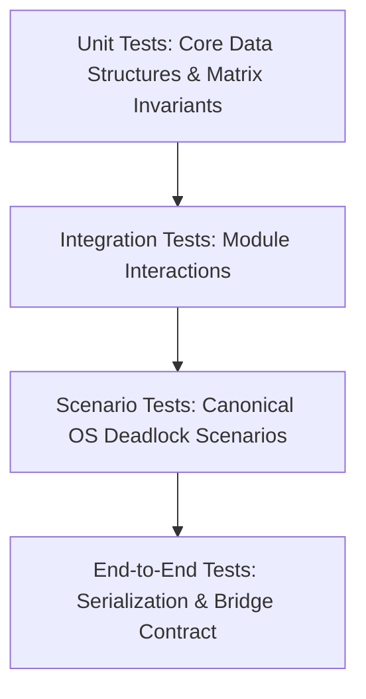

# Deadlock Prevention and Recovery System: Requirements Specification

**Project Title:** Deadlock Prevention and Recovery System  
**Course-Based Project (CBP):** Advanced Operating Systems & Systems Architecture  
**Document Version:** 2.1.0 (Final Project Release: Full C++ Engine, Manual Sandbox & Web REST Bridge Integration)  
**Author:** Senior OS Systems Engineer & Software Architect  
**Status:** All Phases Completed & Verified (47/47 Automated Tests Passing)  

---

## 1. Executive Summary & Purpose

In modern multiprogrammed operating systems, concurrent processes compete for a finite set of non-preemptable and preemptable resources. When resource allocation is unconstrained, circular wait chains may form, culminating in **deadlock**—a permanent state of blocked execution where every process in a set waits for an event that only another process in the same set can cause.

The objective of this Course-Based Project (CBP) is to design and build an **interactive, rigorous, user-space Deadlock Management Simulator**. The simulator models multi-threaded / multiprocess resource allocation across systems with multiple resource types and multiple resource instances. It implements formal operating systems strategies:
- **Deadlock Prevention** (statically invalidating Coffman conditions a priori),
- **Deadlock Avoidance** (dynamically guaranteeing safe states via Banker's algorithm),
- **Deadlock Detection** (analyzing runtime allocation and request matrices for multi-instance resources), and
- **Deadlock Recovery** (restoring throughput via heuristic victim termination and resource preemption with rollback).

This document establishes the functional, non-functional, mathematical, and verification requirements governing the C++ core engine and its frontend integration.

---

## 2. Fundamental Operating Systems Theory & Comparative Framework

### 2.1 The Four Coffman Conditions
As established by Edward G. Coffman Jr. et al. (1971), a deadlock can arise if and only if all four of the following conditions hold simultaneously within the system:

1. **Mutual Exclusion:** At least one resource must be held in a non-shareable mode; only one process may hold the resource instance at any given time.
2. **Hold and Wait:** A process must currently hold at least one resource while simultaneously requesting additional resources currently allocated to other processes.
3. **No Preemption:** Resources cannot be forcibly seized from a process; a resource can only be released voluntarily by the holding process after it finishes its task.
4. **Circular Wait:** There must exist a closed chain of processes $\{P_0, P_1, \dots, P_{n-1}\}$ such that $P_0$ is waiting for a resource held by $P_1$, $P_1$ is waiting for a resource held by $P_2$, ..., and $P_{n-1}$ is waiting for a resource held by $P_0$.

---

### 2.2 Deep-Dive Comparative Matrix: Prevention vs. Avoidance vs. Detection vs. Recovery

A critical requirement of this project is maintaining strict conceptual and algorithmic boundaries between the four fundamental deadlock management strategies.

| Dimension | Deadlock Prevention | Deadlock Avoidance | Deadlock Detection | Deadlock Recovery |
| :--- | :--- | :--- | :--- | :--- |
| **Operating Principle** | Constrain resource request protocols so that at least **one** Coffman condition is mathematically impossible to satisfy. | Evaluate each resource request dynamically at runtime to ensure the system never transitions into an **unsafe state**. | Allow unrestricted allocation as long as resources are physically available; periodically run graph/matrix reduction algorithms to identify deadlocks. | Invoked after detection confirms a deadlock; breaks the circular wait by aborting processes or preempting resources. |
| **Required Knowledge** | None regarding future process behavior. Requires adherence to static protocol rules (e.g., total resource ordering). | **A priori knowledge** of each process's maximum resource claims ($\text{Max}[i][j]$) throughout its lifecycle. | Only current allocation state ($\text{Allocation}$) and active outstanding requests ($\text{Request}$). | Process priorities, resource costs, execution elapsed time, and checkpointed states. |
| **Timing of Action** | Compile-time / Protocol specification time (preventative rules enforced upon every request). | Runtime, synchronously on **every** resource request. | Runtime, either periodically, on resource exhaustion, or on demand. | Runtime, reactively after detection flags an active deadlock. |
| **System Overhead** | Low runtime compute overhead, but causes severe **underutilization** of resources and artificial process throttling. | High per-request compute overhead: $O(m \cdot n^2)$ to evaluate the Banker's safety algorithm on every grant. | Low per-request overhead; periodic compute cost of $O(m \cdot n^2)$ during detection sweep. | High overhead: process work is lost (rollback/termination) and preemption incurs cascading overhead. |
| **Primary Techniques** | 1. Linear Resource Ordering (breaks Circular Wait)<br>2. All-at-once allocation (breaks Hold & Wait)<br>3. Forced surrender of held items (breaks No Preemption) | 1. Dijkstra's Banker's Algorithm (Multi-instance)<br>2. Resource Allocation Graph (RAG) claim-edge cycle checking (Single-instance) | 1. Shoshani-Coffman Multi-Instance Matrix Reduction Algorithm<br>2. Tarjan's / Kosaraju's Cycle Finding on Wait-For Graphs (Single instance) | 1. Process termination (abort all vs. abort one-by-one by cost metric)<br>2. Resource preemption with state rollback and aging against starvation |

---

### 2.3 The "Available $\neq$ Safe" Fallacy & State Topology

> [!CAUTION]
> **Fundamental Theorem of Resource Allocation:** An arbitrary resource request cannot be granted merely because the requested instances are currently available ($\text{Request} \le \text{Available}$).
> 
> Current physical availability is a **necessary** condition for granting a request, but it is **not sufficient** to prevent deadlock under dynamic allocation.

The state space of an OS resource allocator is partitioned as follows:

```
+-------------------------------------------------------------+
|                     ALL SYSTEM STATES                       |
|                                                             |
|   +-----------------------------------------------------+   |
|   |                     SAFE STATES                     |   |
|   |  (Guaranteed safe execution sequence exists:        |   |
|   |   <P_1, P_2, ..., P_n> such that every process can  |   |
|   |   satisfy its maximum claim and complete)           |   |
|   +-----------------------------------------------------+   |
|                              |                              |
|                              v Transition without Avoidance |
|   +-----------------------------------------------------+   |
|   |                    UNSAFE STATES                    |   |
|   |  (No guarantee that all processes can finish;       |   |
|   |   future requests may exceed total availability)    |   |
|   |                                                     |   |
|   |         +---------------------------------+         |   |
|   |         |         DEADLOCKED STATES       |         |   |
|   |         |   (Circular wait chain formed;  |         |   |
|   |         |    progress is halted forever)  |         |   |
|   |         +---------------------------------+         |   |
|   +-----------------------------------------------------+   |
+-------------------------------------------------------------+
```

- **Safe State:** There exists at least one sequence $\langle P_0, P_1, \dots, P_{n-1} \rangle$ of processes such that for each $P_i$, the additional resources $P_i$ can still request ($\text{Need}_i = \text{Max}_i - \text{Allocation}_i$) can be satisfied by the currently available resources plus the resources already held by all preceding processes $P_j$ ($j < i$).
- **Unsafe State:** A state from which the OS cannot prevent processes from eventually deadlocking if they exercise their worst-case maximum claims. **An unsafe state is not automatically a deadlock**, but every deadlock is an unsafe state.
- **Deadlocked State:** A subset of unsafe states where one or more processes are blocked waiting for events that only other blocked processes in the set can produce.

---

## 3. Scope, Boundaries & Non-Goals

### 3.1 In-Scope Capabilities
1. Pure user-space C++ simulation engine modeling processes, discrete resource types, and multiple instances per type.
2. Implementation of static Deadlock Prevention protocols:
   - **Hierarchical / Total Resource Ordering** ($F: R \to \mathbb{N}$).
   - **Hold-and-Wait Invalidation** (Protocol A: Request all up-front; Protocol B: Release all held before new request).
3. Implementation of dynamic Deadlock Avoidance (Banker's Algorithm with multi-instance safety verification).
4. Implementation of Deadlock Detection supporting **multiple instances of resource types** via matrix reduction.
5. Implementation of Deadlock Recovery strategies:
   - Abort all deadlocked processes.
   - Iterative victim selection by heuristic cost function (priority, CPU time, held resources, remaining claim).
   - Resource preemption and process checkpoint rollback.
   - Starvation prevention via priority aging.
6. Generation of comprehensive state snapshots for Resource Allocation Graph (RAG) visualization (bipartite graph with processes, resources, assignment edges, and request edges).
7. Interactive command-line simulation interface and clean JSON serialization ready for local web frontend bridge.

### 3.2 Non-Goals & Out-of-Scope Constraints
1. **No Kernel Drivers / OS Modules:** This project is an architectural simulator executing entirely in user space. It does not interface with the host Windows/Linux kernel scheduler.
2. **No Databases:** No SQL, NoSQL, or external persistent databases. All simulation state resides in memory, with optional file-based JSON snapshots.
3. **No Machine Learning / Neural Networks:** Deadlock management relies on deterministic formal algorithms (Dijkstra, Coffman, Shoshani). Heuristic victim selection uses deterministic algebraic scoring.
4. **No Heavy Frameworks:** The C++ core must rely strictly on standard C++17/20 STL, avoiding bloated external dependencies.

---

## 4. Functional Requirements (FR)

### FR-1: Process and Resource Configuration
- **FR-1.1:** The system shall support dynamic initialization of $m$ distinct resource types ($R_0, R_1, \dots, R_{m-1}$), each configured with a positive integer capacity $C_j \ge 1$.
- **FR-1.2:** The system shall support dynamic initialization of $n$ distinct processes ($P_0, P_1, \dots, P_{n-1}$).
- **FR-1.3:** Each process $P_i$ shall have:
  - An integer identifier (`id`),
  - A human-readable label (`name`),
  - A priority level $\rho_i \in [1, 10]$ (1 = lowest, 10 = highest),
  - A lifecycle state $\sigma_i \in \{\text{NEW}, \text{READY}, \text{RUNNING}, \text{WAITING}, \text{TERMINATED}\}$,
  - An accumulated compute time counter ($t_{\text{cpu}}$),
  - A rollback checkpoint log holding prior allocation records.
- **FR-1.4:** In modes requiring a priori maximum knowledge (Avoidance), each process must declare its maximum claim vector $\text{Max}_i \in \mathbb{N}_0^m$ such that $\forall j \in [0, m-1], \text{Max}[i][j] \le C_j$.
- **FR-1.5 (Dynamic Process & Resource Deletion):** The system shall allow deleting any individual process or resource type:
  - Deleting process $P_i$ shall atomically reclaim all held units back to $\text{Available}$ ($\text{Available}[j] \leftarrow \text{Available}[j] + \text{Allocation}[i][j]$), purge its entries from $\text{Allocation}$, $\text{Request}$, $\text{Max}$, and $\text{Need}$, and re-index surviving processes cleanly.
  - Deleting resource class $R_j$ shall slice out column $j$ across all matrices and vectors, ensuring non-negativity and dimension consistency.
- **FR-1.6 (Manual / Custom Blank Canvas Sandbox):** The system shall support a dedicated `custom_manual` scenario ("Manual / Custom Sandbox (Blank Canvas)") initializing with 0 processes and 0 resources, allowing users to define arbitrary hardware models from scratch, submit customized allocations, and delete components at will.

---

### FR-2: Resource Allocation and Process Lifecycle
- **FR-2.1 (Request Event):** A process $P_i$ may issue a resource request vector $Y \in \mathbb{N}_0^m$.
- **FR-2.2 (Validation Rule):** The engine shall reject any request where $\exists j : Y[j] < 0$.
- **FR-2.3 (Wait Queue):** If a valid request cannot be granted immediately (either due to insufficient physical resources or violation of safety/prevention policies), process $P_i$ shall transition to the $\text{WAITING}$ state and join a deterministic request queue.
- **FR-2.4 (Execution & Release):** When a process holds all resources required for its step, it may execute. Upon task completion, $P_i$ may release a partial or complete vector of its currently held resources $Z \le \text{Allocation}_i$.
- **FR-2.5 (Termination):** Upon voluntary termination, all resources allocated to $P_i$ are atomically returned to $\text{Available}$, and $P_i$ transitions to $\text{TERMINATED}$.

---

### FR-3: Deadlock Prevention Engine
The system shall provide a configurable prevention module capable of enforcing one of the following protocols:
- **FR-3.1 (Circular Wait Prevention - Total Ordering):**
  - Define a strict bijection $F: R \to \{1, 2, \dots, m\}$.
  - Rule: A process $P_i$ currently holding resource $R_j$ may request an instance of $R_k$ if and only if $F(R_k) > F(R_j)$.
  - Alternatively, if $F(R_k) \le F(R_j)$, $P_i$ must voluntarily release all resources $R_l$ where $F(R_l) \ge F(R_k)$ before issuing the request.
  - The engine shall reject out-of-order requests with a descriptive violation error.
- **FR-3.2 (Hold-and-Wait Prevention - Conservative Allocation):**
  - **Protocol A (All-at-once):** $P_i$ must request all its required resources at invocation time. No subsequent requests are permitted while executing.
  - **Protocol B (Release before request):** $P_i$ may request resources only when it holds zero allocated resources. If it needs additional resources, it must release all currently allocated resources first.

---

### FR-4: Deadlock Avoidance Engine (Banker's Algorithm)
- **FR-4.1 (Safety Algorithm):** Given current vectors $\text{Available}$, $\text{Allocation}$, and $\text{Need}$:
  1. Let $\text{Work} = \text{Available}$ and $\text{Finish}[i] = \text{false}$ for all $i \in [0, n-1]$.
  2. Find an index $i$ such that $\text{Finish}[i] == \text{false}$ and $\text{Need}_i \le \text{Work}$.
  3. If found: $\text{Work} = \text{Work} + \text{Allocation}_i$, $\text{Finish}[i] = \text{true}$, append $P_i$ to $\text{SafeSequence}$; repeat step 2.
  4. If all $\text{Finish}[i] == \text{true}$, the state is **SAFE**; otherwise, it is **UNSAFE**.
- **FR-4.2 (Resource-Request Algorithm):** When $P_i$ requests vector $Y$:
  1. If $Y > \text{Need}_i$, raise an error (Process exceeded its declared maximum claim).
  2. If $Y > \text{Available}$, $P_i$ must wait ($\text{WAITING}$).
  3. Speculatively simulate allocation:
     $$\text{Available}' = \text{Available} - Y$$
     $$\text{Allocation}_i' = \text{Allocation}_i + Y$$
     $$\text{Need}_i' = \text{Need}_i - Y$$
  4. Run Safety Algorithm on tentative state.
  5. If SAFE, commit allocation and transition $P_i$ to $\text{RUNNING}$.
  6. If UNSAFE, rollback tentative changes, preserve previous state, transition $P_i$ to $\text{WAITING}$, and log reason: *"Granting request would lead to an unsafe state."*

---

### FR-5: Deadlock Detection Engine (Multi-Instance Resources)
- **FR-5.1 (Multi-Instance Detection Algorithm):**
  The engine shall detect deadlocks in systems with multiple instances per resource type using the matrix reduction algorithm (Shoshani & Coffman):
  1. Let $\text{Work} = \text{Available}$.
  2. For $i = 0$ to $n-1$:
     - If $\text{Allocation}_i == \vec{0}$, set $\text{Finish}[i] = \text{true}$;
     - Else, set $\text{Finish}[i] = \text{false}$.
  3. Find an index $i$ such that $\text{Finish}[i] == \text{false}$ and $\text{Request}_i \le \text{Work}$.
  4. If found:
     $$\text{Work} = \text{Work} + \text{Allocation}_i$$
     $$\text{Finish}[i] = \text{true}$$
     Repeat Step 3.
  5. If $\exists i$ such that $\text{Finish}[i] == \text{false}$, the system is in **DEADLOCK**, and the set of deadlocked processes is:
     $$\mathcal{D} = \{P_i \mid \text{Finish}[i] == \text{false}\}$$
- **FR-5.2:** The detection engine shall output:
  - Boolean `isDeadlocked`,
  - Set of deadlocked process IDs $\mathcal{D}$,
  - List of blocked request vectors,
  - Remaining available work vector at the point of deadlock.

---

### FR-6: Deadlock Recovery Engine
When $\mathcal{D} \neq \emptyset$, the recovery module shall provide automated and manual recovery workflows:
- **FR-6.1 (Recovery by Process Termination):**
  - **Strategy A (Abort All):** Terminate all $P \in \mathcal{D}$ simultaneously, reclaim their resources, and reset their state.
  - **Strategy B (Iterative Abort by Cost Metric):**
    Evaluate a cost function for each $P_i \in \mathcal{D}$:
    $$\text{Cost}(P_i) = w_1 \cdot \rho_i + w_2 \cdot t_{\text{cpu}}(P_i) - w_3 \cdot \sum_{j=1}^m \text{Allocation}[i][j] + w_4 \cdot \text{RemainingTime}(P_i)$$
    Select the victim $P_v = \arg\min_{P \in \mathcal{D}} \text{Cost}(P)$, terminate $P_v$, reclaim $\text{Allocation}_v$, re-run Detection Algorithm, and repeat until $\mathcal{D} = \emptyset$.
- **FR-6.2 (Recovery by Resource Preemption & Checkpointing):**
  - Maintain a historical state stack / checkpoint for each process.
  - Preempt specific resources from a victim $P_v$, roll back $P_v$ to a state prior to resource acquisition, and assign preempted resources to a deadlocked process.
- **FR-6.3 (Starvation Prevention):**
  - Track a preemption counter $\kappa_i$ for each process.
  - Increment $\kappa_i$ each time $P_i$ is chosen as a victim.
  - Add an aging factor $- w_{\text{starve}} \cdot \kappa_i$ to ensure the same process is not repeatedly victimized.

---

### FR-7: System State Serialization and RAG Generation
- **FR-7.1:** The simulator shall serialize the complete system state to a structured JSON format containing:
  - Vector of resource types with capacities and available counts,
  - Vector of processes with lifecycle states, priorities, and cost metrics,
  - Allocation, Max, Need, and Request matrices,
  - Safe sequence (if in Avoidance mode),
  - Deadlock status and deadlocked process list (if in Detection mode).
- **FR-7.2 (RAG Bipartite Graph Generation):**
  The engine shall generate graph primitives for SVG rendering:
  - Process nodes $V_P = \{P_0, \dots, P_{n-1}\}$ (rendered as circular nodes),
  - Resource nodes $V_R = \{R_0, \dots, R_{m-1}\}$ (rendered as rectangular nodes containing instance dots),
  - Assignment edges $(R_j \to P_i)$ representing active allocations ($\text{Allocation}[i][j] > 0$),
  - Request edges $(P_i \to R_j)$ representing outstanding blocked requests ($\text{Request}[i][j] > 0$),
  - Visual highlighting of cycles and deadlocked nodes in warning colors (e.g., `#EF4444`).

---

### FR-8: Simulation Control and Execution Modes
- **FR-8.1:** The simulator shall support two execution paradigms:
  - **Interactive Step-by-Step Mode:** User manually submits commands (`request`, `release`, `detect`, `recover`, `step`).
  - **Automated Scenario Scripting Mode:** Executes a JSON or text-based trace script simulating concurrent events with deterministic step increments.
- **FR-8.2:** The simulator shall support an **Undo / Step Back** mechanism to revert the last state transition for educational demonstration.

---

## 5. Non-Functional Requirements (NFR)

### NFR-1: Algorithmic Correctness and Formal Guarantees
- The Safety Algorithm, Banker's Resource-Request Algorithm, and Multi-Instance Deadlock Detection Algorithm must strictly adhere to standard Operating Systems proofs (Silberschatz, Galvin & Gagne, 10th Ed.).
- The system must never falsely report a safe state as deadlocked, nor report a deadlocked state as safe.

### NFR-2: Computational Performance & Complexity
- All matrix operations shall operate within theoretical bounds:
  - Safety check: $O(m \cdot n^2)$ where $m \le 20, n \le 100$.
  - Detection check: $O(m \cdot n^2)$.
  - Request validation: $O(m)$.
- Maximum execution latency for a complete simulation step on modern hardware shall not exceed 5 milliseconds.

### NFR-3: Modularity, Extensibility & Clean Code
- C++ core code must strictly follow modern C++17/C++20 standards:
  - Use `std::vector`, `std::unique_ptr`, `std::optional`, `std::string_view`.
  - Zero raw pointer ownership (`new`/`delete` avoided).
  - Clean separation of interface (`.hpp`) and implementation (`.cpp`).
  - No monolithic God-objects; each strategy (prevention, avoidance, detection, recovery) must be isolated in its own decoupled module.

### NFR-4: Portability
- The C++ engine must compile with zero warnings under:
  - MSVC (`cl.exe` / Visual Studio 2022 / Windows SDK),
  - GCC 11+ (`g++ -Wall -Wextra -Wpedantic`),
  - Clang 13+ (`clang++`).
- Build configuration must be driven by standard `CMakeLists.txt` (version 3.16+).

### NFR-5: Determinism and Reproducibility
- Given identical configuration scripts and initial matrices, the simulator must produce byte-for-byte identical state sequences across repeated runs and platforms.

### NFR-6: Usability & Observability
- Every state change must produce human-readable, educational console logs explaining **why** an action succeeded or failed (e.g., *"Process P2 request for [1, 0, 2] deferred: Available is [1, 1, 0], which satisfies physical count, but would leave the system with no safe execution sequence."*).

---

## 6. Input Validation & Error Handling Specification

The simulator must strictly validate all inputs and system states against the following invariants:

```
+--------------------------------------------------------------------------------------------------+
|                                    SYSTEM INVARIANTS                                             |
+--------------------------------------------------------------------------------------------------+
| 1. Capacity Conservation:                                                                        |
|    For all j in [0, m-1]: Available[j] + Sum_{i=0}^{n-1} Allocation[i][j] == Capacity[j]         |
|                                                                                                  |
| 2. Non-Negativity:                                                                               |
|    Available[j] >= 0, Allocation[i][j] >= 0, Max[i][j] >= 0, Need[i][j] >= 0, Request[i][j] >= 0  |
|                                                                                                  |
| 3. Need Consistency (Avoidance Mode):                                                            |
|    Need[i][j] == Max[i][j] - Allocation[i][j] >= 0                                               |
|                                                                                                  |
| 4. Claim Bound (Avoidance Mode):                                                                 |
|    Max[i][j] <= Capacity[j]                                                                      |
|    Request[i][j] <= Need[i][j]                                                                  |
|                                                                                                  |
| 5. Release Bound:                                                                                |
|    ReleaseAmount[i][j] <= Allocation[i][j]                                                       |
+--------------------------------------------------------------------------------------------------+
```

### Validation Error Codes

| Error Code | Error Condition | System Action |
| :--- | :--- | :--- |
| `ERR_INVALID_DIM` | Matrix dimension mismatch ($n \times m$ inconsistent). | Reject configuration with parse error. |
| `ERR_EXCEEDS_CAPACITY` | Declared $\text{Max}[i][j] > \text{Capacity}[j]$. | Reject process registration. |
| `ERR_EXCEEDS_CLAIM` | $\text{Request}[i][j] > \text{Need}[i][j]$ (Avoidance). | Terminate process or reject request with exception. |
| `ERR_INVALID_RELEASE` | Process attempts to release resources it does not hold. | Reject release command; keep state unchanged. |
| `ERR_ORDER_VIOLATION` | Process requests resource $R_k$ when holding $R_j$ and $F(R_k) \le F(R_j)$. | Reject request; log Circular Wait protocol violation. |
| `ERR_HOLD_WAIT_VIOLATION`| Process requests resources while already holding resources under Hold-and-Wait prevention. | Reject request; log Hold-and-Wait protocol violation. |
| `ERR_NEGATIVE_VAL` | Negative integer supplied for count or capacity. | Reject input immediately. |

---

## 7. Comprehensive Verification & Testing Strategy

The verification strategy incorporates automated test suites covering four distinct levels:



### 7.1 Scenario Test Matrix

#### Scenario 1: Deadlock-Free Safe Workflow (Avoidance)
- **Configuration:** 3 processes ($P_0, P_1, P_2$), 3 resources ($R_0: 10, R_1: 5, R_2: 7$).
- **Action Sequence:** Valid sequences of requests and releases.
- **Expected Outcome:** State remains continuously SAFE; Banker's algorithm generates a valid sequence (e.g., $\langle P_1, P_0, P_2 \rangle$); all processes complete.

#### Scenario 2: Unsafe State Transition Blocked (Avoidance)
- **Configuration:** Classical Silberschatz 5-process, 3-resource benchmark.
  - $\text{Available} = [3, 3, 2]$.
- **Action:** $P_0$ requests $[0, 2, 0]$.
- **Expected Outcome:** Simulator verifies $\text{Request} \le \text{Available}$, speculatively allocates, finds no safe sequence, cancels allocation, restores state, and places $P_0$ in $\text{WAITING}$ state.

#### Scenario 3: Classical Multi-Instance Deadlock Detection
- **Configuration:** 5 processes ($P_0 \dots P_4$), 3 resource types ($A: 7, B: 2, C: 6$).
  - Allocation: $P_0[0, 1, 0]$, $P_1[2, 0, 0]$, $P_2[3, 0, 3]$, $P_3[2, 1, 1]$, $P_4[0, 0, 2]$.
  - $\text{Available} = [0, 0, 0]$.
  - Request: $P_0[0, 0, 0]$, $P_1[2, 0, 2]$, $P_2[0, 0, 0]$, $P_3[1, 0, 0]$, $P_4[0, 0, 2]$.
- **Expected Outcome:**
  - $P_0$ needs $[0, 0, 0] \le [0, 0, 0]$, finishes, releases $[0, 1, 0]$.
  - $P_2$ needs $[0, 0, 0] \le [0, 1, 0]$, finishes, releases $[3, 0, 3]$. $\text{Work} = [3, 1, 3]$.
  - $P_1$ needs $[2, 0, 2] \le [3, 1, 3]$, finishes, releases $[2, 0, 0]$. $\text{Work} = [5, 1, 3]$.
  - $P_3$ needs $[1, 0, 0] \le [5, 1, 3]$, finishes, releases $[2, 1, 1]$.
  - $P_4$ needs $[0, 0, 2] \le [7, 2, 4]$, finishes.
  - **Result:** No deadlock.
- **Sub-case 3B (Deadlock Injection):** Change $P_2$ request to $[0, 0, 1]$.
  - **Result:** Deadlock confirmed; $\mathcal{D} = \{P_1, P_2, P_3, P_4\}$.

#### Scenario 4: Circular Wait Prevention Enforcement
- **Ordering:** $F(R_0) = 1, F(R_1) = 2, F(R_2) = 3$.
- **Action:** Process $P_1$ acquires $R_1$, then requests $R_0$.
- **Expected Outcome:** Prevention engine intercepts request, rejects with `ERR_ORDER_VIOLATION`, and prevents cyclic request.

#### Scenario 5: Hold-and-Wait Prevention (Protocol B)
- **Action:** Process $P_0$ holds $R_0$ and attempts to request $R_1$.
- **Expected Outcome:** Intercepted and rejected with `ERR_HOLD_WAIT_VIOLATION`. Process must release $R_0$ before requesting $R_1$.

#### Scenario 6: Recovery by Process Termination (Iterative Cost-Based)
- **Trigger:** Active deadlock from Scenario 3B.
- **Action:** Invoke `RecoveryEngine::recover(STRATEGY_ITERATIVE_TERMINATION)`.
- **Expected Outcome:** Lowest-cost process terminated; its resources released to $\text{Available}$; detection algorithm rerun; remaining processes successfully complete without further termination.

#### Scenario 7: Recovery by Preemption & Rollback
- **Trigger:** Active deadlock.
- **Action:** Preempt resource $R_2$ from process $P_4$, restore $P_4$'s previous checkpoint, allocate $R_2$ to $P_1$.
- **Expected Outcome:** Deadlock broken, $P_1$ completes, starvation counter $\kappa_4$ incremented.

#### Scenario 8: Malformed / Invalid Input Boundary Tests
- Requesting more instances than resource capacity.
- Releasing unallocated resources.
- Negative numbers in configuration matrix.
- Verification that all error codes trigger gracefully without memory leaks or crashes.

---

## 8. Summary of Architectural Interfaces

The requirements dictate four strictly decoupled C++ modules communicating via immutable state snapshots:
1. `core::ResourceManager` (Holds state and executes raw physical allocations)
2. `prevention::PreventionEngine` (Pre-allocation protocol gatekeeper)
3. `detection::DetectionEngine` (Multi-instance matrix reducer)
4. `recovery::RecoveryEngine` (Victim selector, abort handler, preemption coordinator)
5. `bridge::StateSerializer` (Produces JSON state models and RAG graph descriptions)
6. `bridge::HttpServer` & `bridge::ApiRouter` (Native HTTP/1.1 REST Daemon)

---

## 9. Phase 7: Native C++ REST API Bridge & Frontend Integration Requirements

### 9.1 Functional Requirements
- **FR-API-1 (Authoritative State Access):** The REST bridge must expose `GET /api/state` returning the authoritative matrices ($\mathbf{Allocation}, \mathbf{Request}, \mathbf{Max}, \mathbf{Need}$) and vector $\mathbf{Available}$.
- **FR-API-2 (Entity Registration):** The bridge must support dynamic registration of processes (`POST /api/processes`) and resource types (`POST /api/resources`).
- **FR-API-3 (Request Submission):** `POST /api/requests` must validate requests against active prevention policies, allocate immediately if available, or queue requests with process state set to `WAITING`.
- **FR-API-4 (Resource Release):** `POST /api/release` must relinquish held units, auto-grant eligible pending requests, and enforce conservation invariants.
- **FR-API-5 (Prevention Policy Configuration):** `POST /api/prevention/policy` must support dynamic toggling of `HOLD_AND_WAIT_CONSERVATIVE`, `CIRCULAR_WAIT_TOTAL_ORDER`, or `NONE`.
- **FR-API-6 (Deadlock Detection):** `POST /api/detection/run` must execute Shoshani-Coffman matrix reduction and return the unreduced candidate set $\mathcal{D}$.
- **FR-API-7 (Victim Recovery):** `POST /api/recovery/terminate` must support manual victim selection and heuristic strategies (`MIN_COST`, `LOW_PRIO`, `HIGH_ALLOC`), abort the process, reclaim resources, and re-run detection.
- **FR-API-8 (Audit Trail):** `GET /api/events` must return timestamped events across `SCENARIO`, `DETECTION`, `RECOVERY`, and `PREVENTION` categories. `POST /api/events/clear` must purge the log.
- **FR-API-9 (Scenario Management):** `POST /api/scenario/load` and `POST /api/scenario/reset` must deterministically initialize canonical benchmark scenarios.

### 9.2 Non-Functional & Security Requirements
- **NFR-API-1 (Zero External Dependencies):** The HTTP daemon must compile using standard C++17 and OS socket libraries (`ws2_32` on Windows).
- **NFR-API-2 (Input Sanitization & Safe Errors):** Malformed JSON, out-of-bounds entity IDs, or excessive claims must return standard HTTP status codes (`400 Bad Request`, `404 Not Found`, `422 Unprocessable Entity`) with escaped JSON error descriptions.
- **NFR-API-3 (Sub-Millisecond Latency):** REST endpoints must execute in $< 5\,\text{ms}$ to ensure real-time UI interactivity.

These specifications serve as the baseline for the system architecture detailed in [architecture.md](file:///c:/Users/raksh/OneDrive/Desktop/deadlock_prevention/architecture.md).
